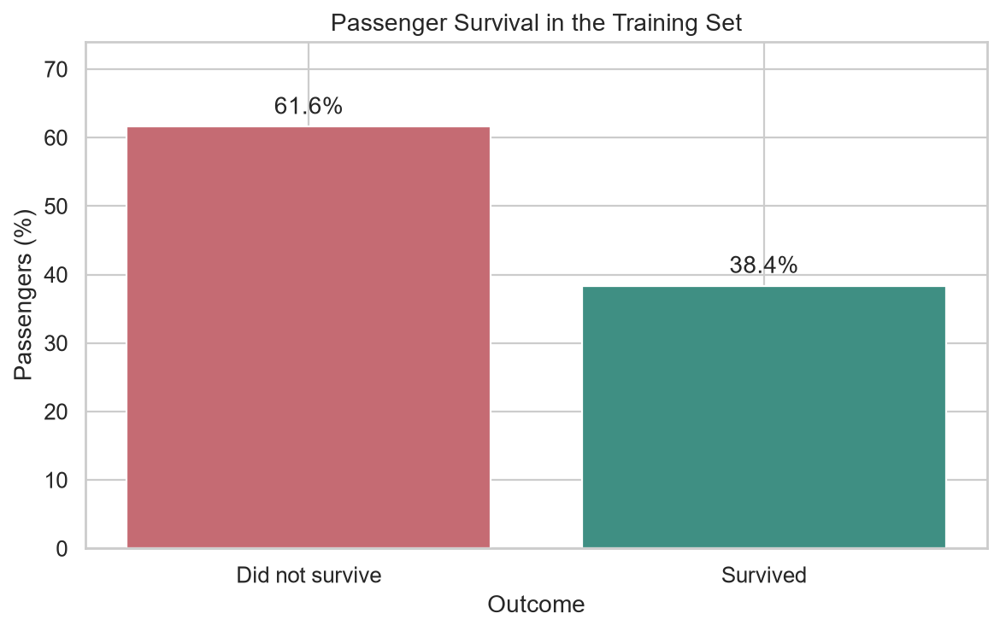

# Titanic Exploratory Data Analysis with Python

A beginner-friendly analysis of the Kaggle Titanic training dataset. It inspects data shape, types, missing values and duplicates, then compares survival by sex, passenger class, and age group. Charts use percentages within groups and normalized age histograms so group-size differences do not obscure the comparison.

**Roadmap project:** https://roadmap.sh/projects/titanic-eda-python



## Dataset

Download **`train.csv`** from the [Kaggle Titanic: Machine Learning from Disaster competition](https://www.kaggle.com/competitions/titanic/data). A Kaggle account and acceptance of the competition rules may be required. Put the downloaded file here:

```text
data/train.csv
```

The CSV is intentionally not committed to this repository. The project is written for the competition's training file and validates the expected columns before analysis.

## Run the analysis

Python 3.10 or newer is recommended.

```bash
python -m venv .venv
```

Activate the environment, then install packages and run:

```bash
# Windows PowerShell
.venv\Scripts\Activate.ps1

# macOS / Linux
source .venv/bin/activate

python -m pip install -r requirements.txt
python titanic_eda.py
```

The script prints data-quality summaries and short findings, and saves charts to `outputs/`.

## Jupyter Notebook

Start Jupyter from the project folder:

```bash
jupyter notebook
```

Open `titanic_eda.ipynb` and run cells from top to bottom. The notebook includes observations immediately below the relevant charts.

## Analysis choices

- Survival rates are calculated within each sex, passenger class, and age group.
- Age bands are 0–12, 13–17, 18–35, 36–59, and 60+ years.
- The age histogram normalizes survivor and non-survivor distributions separately (`common_norm=False`). Passengers with unknown ages are excluded only from age-based analysis; the notebook reports how many are missing.
- These are descriptive patterns in the training sample, not causal conclusions or predictions about individuals.

## Project structure

```text
titanic-eda-python/
├── data/
│   └── train.csv                 # Download from Kaggle; not committed
├── outputs/                      # Generated charts; not committed
├── overall_survival.png          # README preview
├── titanic_eda.ipynb
├── titanic_eda.py
└── requirements.txt
```
